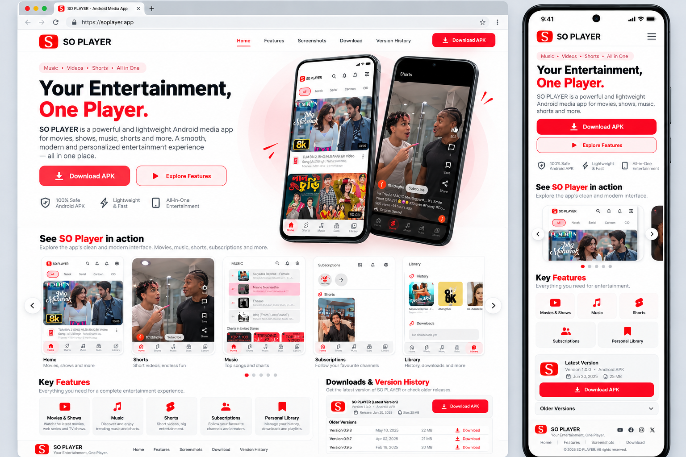

# So Player

MASTER PROMPT — SO PLAYER OFFICIAL WEBSITE


1. PROJECT OVERVIEW

Build a complete, modern, premium, fully responsive official website for an Android entertainment application named SO PLAYER.

The website must closely replicate the provided first website reference image. Treat the reference image as the primary visual blueprint. Recreate its layout, spacing, colors, typography, cards, buttons, navigation, screenshot gallery, download sections, and overall visual appearance as accurately as possible.

Do not create a generic app landing page. The objective is to reproduce the supplied reference design as closely as possible while making it a real, functional website.

Website name: SO PLAYER
Website tagline: Your Entertainment, One Player.
Application platform: Android
Application type: Entertainment / Media Player
Primary brand color: Bright Red (#FF101B)
Secondary color: White (#FFFFFF)
Background: White / Very Light Gray
Text: Dark Black / Gray
Design style: Modern, Minimal, Premium, Clean.

---

2. MOST IMPORTANT: REFERENCE IMAGES

I will provide the following reference images:

1. The first generated SO PLAYER website design image (desktop and mobile mockup).
2. SO PLAYER application logo/splash screen.
3. Home screen screenshot.
4. Shorts screen screenshot.
5. Music screen screenshot.
6. Subscriptions screen screenshot.
7. Library screen screenshot.

Use these images as actual website assets.

IMPORTANT IMAGE INSTRUCTIONS:

- Use the exact SO PLAYER application screenshots provided.
- Do not replace the screenshots with random stock images.
- Do not recreate or redraw the application screenshots.
- Do not change the screenshots' original colors or interface.
- Preserve the original screenshot proportions.
- Use the first reference website image as the main design reference.
- The app logo must use the red rounded-square icon with the white letter "S".
- Do not use the YouTube logo as the SO PLAYER logo.
- The website must consistently use the SO PLAYER branding.

Use the provided screenshots in the hero section, application preview gallery, and other appropriate areas.

---

3. WEBSITE LOGO AND BRANDING

Create a professional header with the following branding:

Logo:

- Red rounded rectangle.
- White capital letter S in the center.
- Similar appearance to the provided app icon.

Brand name:
SO PLAYER

Logo size:
Approximately 42px on desktop and 36px on mobile.

Brand name typography:
Bold, modern, dark text.

Header layout:

- Logo on the left.
- Brand name beside the logo.
- Navigation menu in the center/right.
- Red Download APK button on the right.

Navigation items:

- Home
- Features
- Screenshots
- Download
- Version History

Make the navigation links functional with smooth scrolling.

On mobile, replace desktop navigation with a hamburger menu.

---

4. DESKTOP HOMEPAGE DESIGN

Desktop target resolution:
1440px × 900px.

The website should look very similar to the first reference image.

SECTION A — HEADER

Create a clean white navigation bar.

Left:
SO PLAYER logo and brand name.

Center:
Home | Features | Screenshots | Download | Version History

Right:
A prominent red Download APK button with a download icon.

Header requirements:

- Sticky navigation.
- White background.
- Thin light-gray bottom border.
- Smooth hover effects.
- Responsive layout.

SECTION B — HERO SECTION

Create a large two-column hero section.

LEFT SIDE:

Small rounded red/pink category label:

Music • Videos • Shorts • All in One

Main heading:

Your Entertainment,
One Player.

Make "Your Entertainment," dark black and "One Player." bright red.

Heading typography:

- Large bold font.
- Approximately 46–52px on desktop.
- Modern typography.
- Good line spacing.

Description:

"SO PLAYER is a powerful and lightweight Android media app for movies, shows, music, shorts and more. A smooth, modern and personalized entertainment experience — all in one place."

Below the description, add two buttons:

1. Download APK
   
   - Red background.
   - White download icon.
   - White bold text.
   - Rounded corners.

2. Explore Features
   
   - White background.
   - Red border.
   - Red text.
   - Play or arrow icon.

Below the buttons, add three small benefit indicators:

- 100% Safe Android APK
- Lightweight & Fast
- All-in-One Entertainment

Use suitable minimalist icons.

RIGHT SIDE:

Create an attractive application showcase using the provided SO PLAYER screenshots.

Display two or three overlapping smartphone mockups.

Use:

- Home screenshot.
- Shorts screenshot.
- Music screenshot.

Add realistic smartphone frames, rounded corners, subtle shadows and a soft red/pink background glow.

The smartphones should look like real Android devices.

Do not use random screenshots.

SECTION C — APPLICATION SCREENSHOTS

Section heading:

See SO Player in action

Description:

"Explore the app's clean and modern interface. Movies, music, shorts, subscriptions and more."

Create a horizontal screenshot carousel.

Display five screenshot cards:

1. Home
2. Shorts
3. Music
4. Subscriptions
5. Library

Each card must include:

- Original application screenshot.
- Rounded corners.
- Light shadow.
- Screenshot title.
- Short description.

Descriptions:

Home — Movies, shows and more.

Shorts — Short videos, endless fun.

Music — Top songs and charts.

Subscriptions — Follow your favourite channels.

Library — History, downloads and more.

Carousel functionality:

- Previous arrow.
- Next arrow.
- Smooth sliding animation.
- Pagination dots.
- Touch/swipe support.
- Responsive card sizing.

On desktop, show multiple screenshots at once.

On mobile, show one main screenshot and a small portion of the next screenshot.

SECTION D — KEY FEATURES

Section title:

Everything You Need

Subtitle:

"Powerful features for your complete entertainment experience."

Create five modern feature cards:

1. Movies & Shows
   Watch the latest movies, web series and more.

2. Music
   Discover and enjoy trending music and charts.

3. Shorts
   Short videos, big entertainment.

4. Subscriptions
   Follow your favourite channels and creators.

5. Personal Library
   Manage your history, downloads and playlists.

Design:

- White or very light-gray cards.
- Rounded corners.
- Red icons.
- Subtle shadows.
- Clean typography.
- Smooth hover animations.

SECTION E — DOWNLOADS & VERSION HISTORY

This is a very important section.

Section title:

Downloads & Version History

Subtitle:

"Get the latest version of SO PLAYER or check older releases."

Create two main areas.

LEFT AREA — LATEST VERSION:

A prominent download card containing:

- SO PLAYER logo.
- Latest Version label.
- Version number.
- Android APK label.
- Release date.
- APK file size.
- Download APK button.

Example information (use placeholders until actual release information is supplied):

Version 1.0.0
Android APK
Release Date: [RELEASE_DATE]
File Size: [FILE_SIZE]

The Download APK button must link to the actual APK file.

RIGHT AREA — OLDER VERSIONS:

Create a clean version history table.

Example:

Version 0.9.8 | Release Date | File Size | Download

Version 0.9.7 | Release Date | File Size | Download

Version 0.9.5 | Release Date | File Size | Download

Version 0.9.0 | Release Date | File Size | Download

Version 0.8.5 | Release Date | File Size | Download

Each version must have its own download link.

IMPORTANT:

Design the version system so that I can easily add new application versions in the future.

Store version information in a separate data structure or JSON file.

Do not hardcode every version directly into the page layout.

Make it easy to update:

- Version number.
- Release date.
- APK download URL.
- APK file size.
- Release notes.
- Latest version status.

The latest version should be automatically highlighted.

Add a View All Versions option if there are many releases.

---

5. MOBILE WEBSITE DESIGN

Mobile target widths:

- 360px
- 375px
- 390px
- 412px
- 430px

The mobile website is equally important as the desktop website.

Do not simply shrink the desktop website.

Create a properly optimized mobile layout based on the mobile design shown in the reference image.

MOBILE HEADER

Top navigation:

- SO PLAYER logo on the left.
- Hamburger menu on the right.

Use a compact white header.

The navigation menu should open and close smoothly.

MOBILE HERO SECTION

Display elements vertically.

Order:

1. Category badge.
2. Main heading.
3. Description.
4. Download APK button.
5. Explore Features button.
6. Three small feature indicators.
7. Application smartphone preview.

Main heading:

Your Entertainment,
One Player.

Use approximately 30–34px font size.

Buttons:

- Full width.
- Comfortable touch height.
- Rounded corners.
- Red primary button.

The smartphone showcase must fit the mobile screen without horizontal overflow.

MOBILE SCREENSHOT GALLERY

Display one large screenshot card at a time.

Add:

- Swipe support.
- Previous and next arrows.
- Pagination dots.
- Smooth transitions.

Preserve original screenshot proportions.

MOBILE FEATURES

Use a responsive grid.

First row:

- Movies & Shows
- Music
- Shorts

Second row:

- Subscriptions
- Personal Library

Cards should have comfortable spacing and clear icons.

MOBILE DOWNLOAD SECTION

Display a full-width latest version card.

Include:

- SO PLAYER logo.
- Version number.
- Release date.
- APK size.
- Large Download APK button.

Below it, display an Older Versions accordion.

When clicked, it should expand and show all older versions with their download buttons.

Do not make the version table too wide for mobile.

MOBILE FOOTER

Display:

- SO PLAYER logo.
- Brand name.
- Short tagline.
- Home.
- Features.
- Screenshots.
- Download.
- Version History.
- Social media links, if provided.
- Copyright information.

Keep the footer compact and clean.

---

6. FOOTER DESIGN

Create a professional footer matching the reference design.

Left:
SO PLAYER logo and tagline.

Center:
Navigation links.

Right:
Social media icons.

Bottom:
Copyright © 2026 SO PLAYER. All rights reserved.

Use a subtle top border and white background.

---

7. FUNCTIONAL REQUIREMENTS

The website must be a real working website, not just a visual mockup.

Implement:

1. Responsive desktop navigation.
2. Functional mobile hamburger menu.
3. Smooth scrolling navigation.
4. Working screenshot carousel.
5. Touch/swipe screenshot navigation.
6. Working Download APK buttons.
7. Separate download links for each version.
8. Expandable older versions section.
9. Smooth hover effects.
10. Responsive image loading.
11. Proper footer navigation.
12. SEO-friendly page title and metadata.
13. Accessible buttons and navigation.
14. Fast loading and optimized images.

Use placeholder download URLs only until I provide the actual APK links.

Never create fake download links or claim that an APK is available when no file has been supplied.

---

8. TECHNOLOGY STACK

Preferred technologies:

- React.js
- Vite
- Tailwind CSS
- Lucide Icons
- JavaScript

Use reusable components.

Suggested component structure:

- Header
- HeroSection
- AppShowcase
- ScreenshotGallery
- FeatureSection
- DownloadSection
- VersionHistory
- Footer
- MobileNavigation

Keep the code clean, modular and easy to maintain.

Separate:

- Components
- Assets
- Styles
- Version data
- Configuration

Use semantic HTML and responsive CSS.

---

9. DESIGN ACCURACY REQUIREMENTS

This is extremely important.

The first provided website reference image is the primary design target.

Reproduce its visual structure as closely as possible.

Pay special attention to:

- Exact section ordering.
- Overall spacing.
- White background.
- Bright red branding.
- Rounded cards.
- Screenshot placement.
- Smartphone mockup positioning.
- Typography hierarchy.
- Button proportions.
- Soft shadows.
- Desktop two-column hero.
- Mobile single-column layout.
- Download and version history design.

Do not randomly change the design.

Do not introduce unnecessary gradients, dark themes, extra colors, excessive animations or unrelated sections.

The final result should look like the supplied reference design, not a different interpretation.

Use the actual uploaded SO PLAYER screenshots wherever they appear in the design.

---

10. RESPONSIVE TESTING

Test the website at:

DESKTOP:

- 1280px
- 1366px
- 1440px
- 1920px

TABLET:

- 768px
- 820px
- 1024px

MOBILE:

- 360px
- 375px
- 390px
- 412px
- 430px

Requirements:

- No horizontal scrolling.
- No broken images.
- No overlapping text.
- No overflowing buttons.
- No distorted screenshots.
- Proper spacing on all screen sizes.
- Touch-friendly mobile controls.

---

11. FINAL DELIVERY

Deliver a complete, production-ready SO PLAYER official website.

Provide:

1. Complete React source code.
2. All reusable components.
3. Responsive CSS/Tailwind styling.
4. Image asset organization.
5. Version history data configuration.
6. Functional screenshot carousel.
7. Functional download sections.
8. Desktop and mobile layouts.
9. Instructions to run the website locally.
10. Instructions to deploy it online.

Make sure the final website visually matches the first supplied reference image as closely as possible.

The website must feel like the official website of a premium Android entertainment application.

FINAL DESIGN GOAL:

SO PLAYER — Your Entertainment, One Player.

A beautiful, modern, professional, responsive website that looks excellent on both computer screens and mobile phones.

Prioritize visual accuracy to the provided reference image above unnecessary creative redesigns.

This project was built with [Lovable](https://lovable.dev).

**Live app**: https://so-player.lovable.app

## Build with Lovable

Continue developing this project in the [Lovable editor](https://lovable.dev/projects/41c22b09-c6ed-49f2-b0ff-8f87f46046cd).

- **Ship faster**: describe what you want to build and Lovable handles the code.
- **Stay in sync**: every change made in Lovable is committed straight to this repository.
- **Full ownership**: this code is yours. Push to `main` on GitHub and your changes sync back into Lovable, ready for your next prompt.

## Development

Prefer working locally? You need Node.js and npm — [install with nvm](https://github.com/nvm-sh/nvm#installing-and-updating).

```sh
git clone <this-repository-url>
cd <repository-name>
npm i
npm run dev
```
